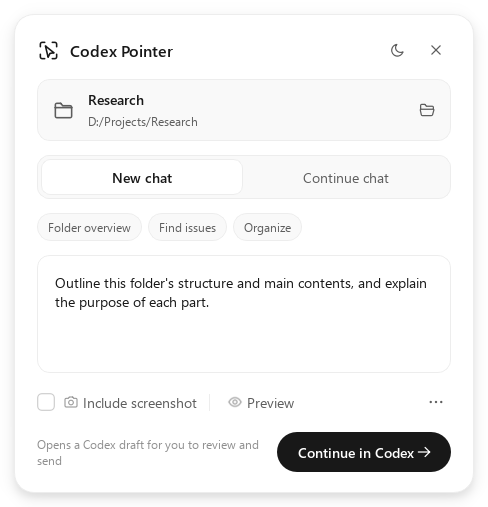
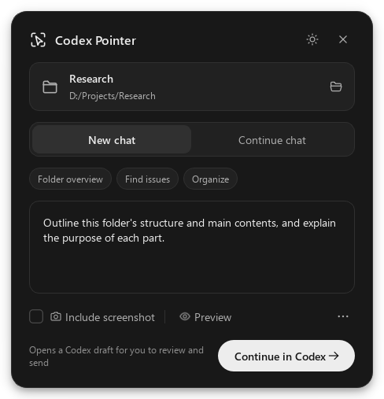
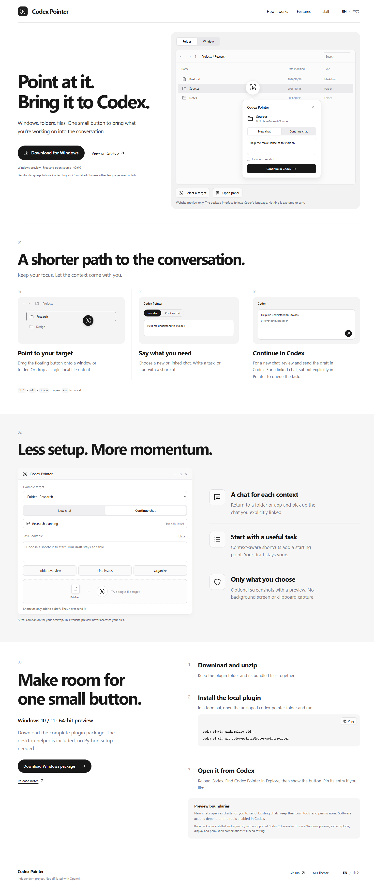

# Codex Pointer

**English** · [简体中文](README.zh-CN.md) · [Website](https://youisan.github.io/codex-pointer/) · [Download](https://github.com/youisan/codex-pointer/releases/latest)

A small Windows companion that brings a window, file, or folder into your Codex chat.

Drag the floating circle onto a target, or drop a file onto the circle. Choose a task and continue in a new or explicitly selected chat. A compact native interface, local context capture, and fewer trips between windows.

| Light | Dark |
| --- | --- |
|  |  |

These previews are rendered from the real Qt interface with synthetic targets; they do not capture a desktop or send a task.

**v0.6.0 is a Windows preview.** This community project is not affiliated with OpenAI. Pointer selects context; the tools available in your Codex chat perform the work. It does not install a universal desktop-control engine.

## What it does

- Follow Codex’s language for an English or Simplified Chinese native interface and task starters. Other languages use English.
- Drag onto an app window or an Explorer item, with a window outline and target preview. Press **Esc** to cancel.
- Drop **one file or folder** onto the circle, including paths containing spaces or Chinese characters and accessible UNC shares. Files are never moved or executed.
- Use target-specific quick tasks. A click fills the composer; existing text is preserved, repeated clicks are deduplicated, and nothing is sent automatically.
- Start a new chat or explicitly select an existing one. Folder and application bindings are remembered independently; a new target never inherits the previous target's chat.
- Reopen recent files and folders, use an optional screenshot preview, and switch between light and dark themes.
- Click the circle again to collapse the panel without losing the current draft. Target lookup stays in the background and ignores stale results.

## Install

Requires **Windows 10/11 x64** and an installed, signed-in Codex desktop client with its native CLI. No separate Python installation is needed for the release ZIP.

1. Download `codex-pointer-0.6.0-windows-x64.zip` from the [latest release](https://github.com/youisan/codex-pointer/releases/latest) and extract it. Keep the complete folder, including the GUI's `_internal` directory.
2. Open the extracted `codex-pointer` folder in Codex, or open a terminal in that folder and run:

   ```powershell
   codex plugin marketplace add .
   codex plugin add codex-pointer@codex-pointer-local
   ```

3. Reload plugins or restart Codex. Find **Codex Pointer** under **Explore**, pin it to the sidebar, and choose **Show button**. You can also run `plugins/codex-pointer/bin/CodexPointer.exe` directly.

The standalone `CodexPointer.exe` is useful for trying the picker. The complete ZIP includes the local MCP context reader, launcher, portable GUI, and third-party notices.

When upgrading, quit the old circle through its context menu before opening the new version. Installation does not replace a GUI process that is already running. The client's built-in **Show Pet** profile-menu item cannot be extended by this plugin; Pointer uses the supported global plugin destination.

## Use

1. Select a target by dragging the circle onto it, dropping a file onto the circle, or choosing a folder from the context menu.
2. Write a request or select a quick task. Screenshots are **off by default**; opt in and preview the exact image before submitting.
3. Choose **New chat** to open a prefilled Codex draft, then confirm sending inside Codex. For **Continue chat**, explicitly select a conversation first.

`Ctrl+Alt+Space` selects the recently focused external app when the shortcut is available. `Ctrl+Enter` triggers the panel's primary action. `Esc` closes an idle panel or cancels an active drag. Native controls and built-in quick tasks follow Codex's language, with English and Simplified Chinese support. Other Codex languages use English. Your own task text is preserved when the language changes.

| Action | Behavior and limits |
| --- | --- |
| New chat | Opens a Codex desktop draft for the selected directory; you confirm sending. |
| Continue chat | Queues text to the explicitly selected chat using the supported native CLI. The chat keeps its own workspace and permissions. |
| Direct create and send | Experimental shared app-server route, available only after a successful connection check. |
| Optional screenshot | Stores a local PNG and attaches a context reference. The bundled MCP reader or an image tool in the chat reads it. |

An accepted or queued task is not a completed task. Connection failures can be ambiguous; check the target chat before retrying.

## Build and verify

Python 3.10–3.12 and PySide6 6.7.0 are used for source development. The MCP host is a separate standard-library executable and does not load Qt.

```powershell
python -m pip install -e . pyinstaller
$env:PYTHONPATH = 'src'
python -m unittest discover -s tests -v
python run.py --smoke-test
powershell -NoProfile -ExecutionPolicy Bypass -File scripts/build.ps1
python scripts/verify_release.py
python scripts/verify_plugin_install.py --codex 'C:\path\to\native\codex.exe'
python scripts/benchmark_switching.py
python scripts/render_readme_previews.py
```

Builds go to `dist/v0.6.0/`: the standalone GUI, MCP host, complete plugin ZIP, SHA256 checksums, and license notices. Source checkouts do not include binaries; build before installing the plugin from source.

Tests use synthetic contexts and owned/offscreen UI. Release verification installs the ZIP in an isolated Codex home to check real plugin discovery, relative executable paths, and global launcher metadata. It does not submit a model task or inspect your screen. The responsiveness benchmark simulates a 600ms lookup; it does not measure complete real-world Explorer latency.

`website/` is a dependency-free bilingual static site. [GitHub Pages](https://docs.github.com/en/pages/getting-started-with-github-pages/using-custom-workflows-with-github-pages) deploys it from `main` through the included workflow.

<details>
<summary>English website preview</summary>



</details>

## Privacy and limitations

- No background screenshots, clipboard reading, key logging, or recursive folder scans. Target metadata is read only during an explicit selection or active drag. Screenshots require an explicit opt-in.
- Explorer lookup verifies the item under the pointer. If it cannot identify that item safely, it may select the current folder and labels that fallback. It never substitutes another selected item.
- A screenshot contains the visible screen rectangle; overlapping windows can appear. Inspect the preview before sending.
- Preferences, at most 100 explicit chat bindings, and up to 8 recent targets are stored in `%LOCALAPPDATA%\CodexPointer\settings.json`. Drafts stay in memory during the current run.
- Context bundles and optional images are stored in `%LOCALAPPDATA%\CodexPointer\captures`. Contexts expire after 24 hours. Old PNGs are cleaned up when a new screenshot is created; you can remove the cache after quitting.
- The MCP reader accepts only context UUIDs from this cache. Launcher tools start only the bundled companion; they do not accept arbitrary commands.
- Target context enters your Codex chat when you send the request. Your account's data settings apply.
- Real Explorer tabs, mixed-DPI monitors, administrator windows, and full desktop task execution need broader environment testing. There is no code signing, installer, or automatic updater in this preview.

## Project layout

```text
src/codex_pointer/       Native Qt UI, Windows metadata, transport and MCP
plugins/codex-pointer/   Portable plugin manifest, MCP config and skill
.agents/plugins/        Local marketplace source
website/                English / Chinese homepage
scripts/                Build, release checks and responsiveness benchmark
tests/                  Offline regression checks
```

## License

Project code and original icons: [MIT](LICENSE). The portable GUI uses replaceable dynamic Qt libraries. Qt, PySide6, Python and PyInstaller retain their own licenses; the release includes `THIRD_PARTY_NOTICES.txt` and `THIRD_PARTY_LICENSES/`.

GitHub distribution and listing in an official plugin directory are separate processes. This repository provides a downloadable community preview; it does not claim official marketplace acceptance.
