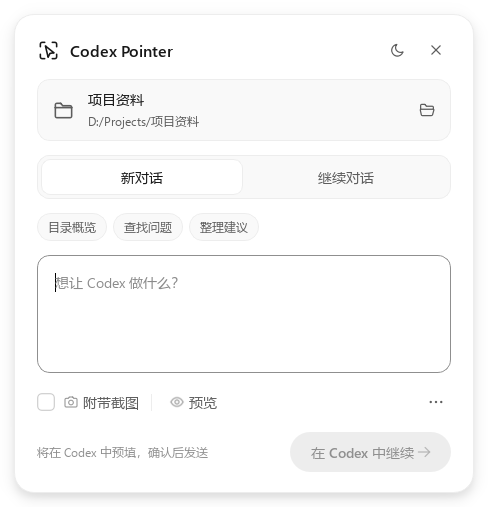
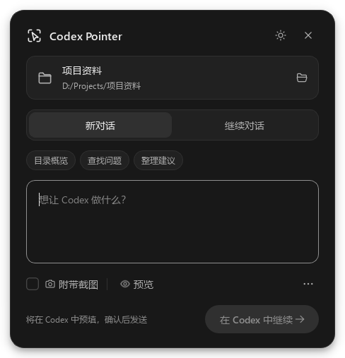

# Codex Pointer

[English](README.md) · **简体中文** · [主页](https://youisan.github.io/codex-pointer/) · [下载安装包](https://github.com/youisan/codex-pointer/releases/latest)

将一个小按钮拖到窗口或文件夹上，把目标上下文带进 Codex。

**0.5.0 是 Windows 预览版。** 新增随对象变化的快捷任务，以及把单个文件或文件夹直接拖入圆圈。已有功能包括按对象记住对话、拖动目标预览和最近对象。客户端内的启动面板可以显示 / 隐藏浮动按钮。原生按钮和紧凑任务面板采用与 Codex 客户端协调的灰阶、字级和圆角，支持浅色 / 深色主题。桌面按钮负责识别目标、整理上下文；Codex 中已有的工具负责执行任务。此项目与 OpenAI 无隶属关系。

| 浅色 | 深色 |
| --- | --- |
|  |  |

上图由真实 Qt 组件离屏渲染。面板默认展示目标、对话选择、快捷任务、任务输入与一个主操作；连接诊断等放进菜单。支持 160ms 展开过渡、悬停和按压反馈、处理状态细环，以及减少动态效果设置。

## 使用体验

1. 安装完整插件并刷新后，在 Codex 侧边栏的 **探索** 中找到 **Codex Pointer**。入口默认未固定，可用其菜单的 **固定到侧边栏**；然后打开面板，点击 **显示按钮**。也可以在聊天中说“打开 Codex Pointer”。独立启动仍可双击 `CodexPointer.exe` 或运行 `launch.ps1`。
2. 拖动箭头到目标窗口或资源管理器中的文件夹上，会显示窗口描边和目标提示；停留后补全文件夹名称，松开选择，`Esc` 取消并恢复按钮位置。单击圆圈打开面板并使用最近聚焦的外部窗口，再次单击收起面板、保留未发送的内容；右键也可选择文件夹或最近对象。
3. 填写任务，例如“解释这个报错”“整理这个文件夹中的资料”。截图默认关闭，可选择目标窗口或鼠标周边，并在发送前预览。
4. 新对话点击 **在 Codex 中继续**，直接使用桌面预填入口。继续对话时先明确选择要绑定的聊天；再次回到同一文件夹或软件时恢复该选择。文件使用所在文件夹的绑定，子文件夹单独记忆；软件按完整程序路径记忆。新对象默认新对话，不继承上个对象的聊天。最近对象最多保留 8 个，窗口不会使用失效句柄重开。

也可以将 **一个本地文件或文件夹拖入圆圈**，高亮后松开即可选中；支持中文、空格和 UNC 共享路径。不会移动或运行源文件，不支持多文件或网页链接；网络路径查询有超时保护。快捷任务随文件夹、文件或软件窗口变化，点击仅填入任务，已有内容追加为独立段落，重复点击不会重复添加，支持撤销；仍需你确认发送。

切换对象时，窗口信息先显示，Explorer 路径在后台补全，期间可以继续输入。新选择会取消旧查询并丢弃过时结果；同一面板原地更新，不反复收起和展开。Explorer 查询复用后台进程，超时后仍可使用窗口信息。识别完成前不能发送。已经删除、不可访问或类型改变的文件夹，在提交时会明确报错。

`Ctrl+Alt+Space` 唤起当前软件目标（快捷键未被其他程序占用时）；`Ctrl+Enter` 执行面板主操作，`Esc` 关闭空闲面板。未发送的任务会在本次程序运行期间保留。深浅主题可在顶栏切换，首次启动跟随 Windows 主题。

启动面板打开时只读取状态，点击显示后才启动辅助程序。**隐藏按钮**保留进程与草稿，之后可再次显示；右键 **退出**才结束程序。隐藏或关闭面板会取消未完成的目标识别；截图或发送任务期间会延后显示 / 隐藏请求。启动请求与显示请求都不代表已确认窗口可见。

入口采用官方 [`global` 侧边栏扩展](https://developers.openai.com/plugins/build/extensions)。截图中头像菜单的 **Show Pet** 是客户端内置入口，目前没有公开接口让第三方插件向该菜单添加同级项目。本机 26.1013 客户端将新 MCP 入口默认收进 **探索**，不自动固定；也可从侧边栏 **自定义** 中管理显示。其他版本的入口名称和可用性可能不同。

| 入口 | 行为 | 当前限制 |
| --- | --- | --- |
| 新对话 · 在 Codex 中继续 | 用官方 `codex://new` 打开指定目录的新对话并填入任务 | 需在 Codex 中按发送；不支持自动发送 |
| 菜单 · 直接创建并发送 | 经共享 app-server 创建对话并提交一轮任务 | 连接检查通过后才启用；属于实验接口，桌面可见性与电脑控制工具取决于宿主 |
| 继续对话 · 发送到此对话 | 用 `codex queue --thread UUID` 排队发送文本 | 需要支持此命令的 Codex CLI 和可用服务；原对话工作区与权限保持其自身配置 |
| 附带截图 | 在本地保存 PNG；消息携带上下文 UUID，由插件 `read_capture` 返回图像 | 需要启用本地插件，或让 Codex 用现有文件/图像工具读取；不是 CLI 图片附件 |

“已接收 / 已排队”表示任务已提交，不表示执行完成。桌面预填只表示向系统提交了打开请求，是否成功打开由 Codex 的协议处理器决定。连接中断时先检查目标对话，避免重复发送。

## 环境与启动

- Windows 10/11，64 位。
- 已安装并登录 Codex；`codex` 命令在 PATH 中，或使用官方桌面安装位置中的 `codex.exe`。
- 源码运行需要 Python 3.10–3.12，使用 PySide6 6.7.0 渲染原生界面。
- EXE 运行不需要另外安装 Python。

```powershell
python -m pip install -e .
python run.py
python run.py --diagnose
python run.py --preview --theme dark
```

`--diagnose` 只检查命令和读取会话，不发送任务。`--preview` 使用示例目标，不截图或发送。共享服务不可用时，新对话默认的桌面预填入口仍可使用。程序不自动重启或修改 Codex，也不会修改用户全局配置。

## 安装本地 Codex 插件

插件提供启动面板、显示 / 隐藏工具，以及通过 `read_capture` 读取被选中的上下文和可选截图的能力。按钮本身是本地辅助程序，完整插件包已包含它。

**Release ZIP 用户**：解压后，在 Codex 中打开包含 `.agents`、`plugins` 的 `codex-pointer` 目录作为项目，然后按下面的本地源步骤安装。按钮位于 `plugins/codex-pointer/bin/CodexPointer.exe`。ZIP 已含运行程序，无需自行构建。

**GitHub 源码用户**：先构建再安装；源码仓库没有提交 EXE，直接从源码安装插件尚不能启动其 MCP 服务。

源码目录：

```text
src/codex_pointer/                 Qt 界面、Windows 目标识别、桥接、MCP
mcp_host.py                       独立轻量 MCP 入口，不加载 Qt
plugins/codex-pointer/             插件清单、技能、MCP 配置
  plugin.json                     Agent Plugins 标准清单
  mcp.json                        固定相对路径的本地 stdio 服务
.agents/plugins/marketplace.json   本仓库的本地插件源
scripts/build.ps1                 生成 Windows EXE 和完整插件 ZIP
tests/                            不发送真实模型任务的回归检查
```

先构建，确保 `plugins/codex-pointer/bin/` 下有两个 EXE。在支持仓库插件源的 Codex 中打开本仓库，在插件目录选择 **Codex Pointer** 本地源并安装，随后重新加载插件或重启客户端，让新增工具和侧边栏入口刷新。不同客户端的插件入口可能有差异，参见[官方插件打包说明](https://developers.openai.com/plugins/build/plugins)。

也可在源码或 Release 解压目录运行以下命令（会将本地源和插件加入你的 Codex 配置）：

```powershell
codex plugin marketplace add .
codex plugin add codex-pointer@codex-pointer-local
```

已有对话首次安装插件后，若工具没有刷新，可以在支持刷新工具的客户端刷新，或使用新对话；消息也提供本地 JSON 路径供现有工具读取。

## 构建和测试

```powershell
python -m pip install -e . pyinstaller
$env:PYTHONPATH = 'src'
python -m unittest discover -s tests -v
python run.py --smoke-test
powershell -NoProfile -ExecutionPolicy Bypass -File scripts/build.ps1
python scripts/verify_release.py
python scripts/verify_plugin_install.py --codex 'C:\path\to\native\codex.exe'
python scripts/benchmark_switching.py
```

产物：

- `dist/v0.5.0/CodexPointer.exe`：独立悬浮按钮。
- `dist/v0.5.0/CodexPointerHost.exe`：独立控制台 MCP 服务，不携带 Qt，可用 `--diagnose` 检查连接。
- `dist/v0.5.0/codex-pointer-0.5.0-windows-x64.zip`：完整插件、便携 GUI、MCP Host、说明和许可证。便携 GUI 的 `_internal` 文件夹必须与 EXE 保持在一起。

新旧版本独立输出，避免覆盖正在运行的程序。升级试用前，从旧按钮的右键菜单退出，再打开新版。

构建脚本不会安装插件或改动 Codex 的用户配置。生成的二进制文件和个人缓存不纳入 Git。

测试涵盖目标识别、截图范围、桥接失败、会话绑定、插件入口元数据、只读加载、启动与显示 / 隐藏控制，以及原生界面的主要交互。启动面板另外用模拟 MCP Apps 宿主检查渲染与点击。`verify_plugin_install.py` 将完整 ZIP 安装到含空格的临时目录与隔离的 `CODEX_HOME`，通过真实 Codex 客户端发现 MCP 工具，验证路径解析与侧边栏元数据。不会向真实 Codex 会话提交任务。

`benchmark_switching.py` 使用自有 Qt 组件和模拟的 600ms 路径查询，检查连续切换和识别中输入，不读取真实桌面或提交任务。开发机上切换调用约 1–2ms 返回，10ms 心跳的 p95 间隔约 12–15ms；这是界面响应指标，不代表完整 Explorer 识别耗时。实际路径识别取决于资源管理器、目录大小与可访问性服务，仍需真实环境验证。

Qt / PySide 的第三方通知与许可证随产物一起分发。项目本身的 MIT 许可证不改变依赖组件的许可；完整插件包使用可替换的动态 Qt 库。详情见产物中的 `THIRD_PARTY_NOTICES.txt`。

## 隐私与识别边界

- 没有后台截图、键盘记录或剪贴板读取；只有用户主动拖动、点击或选择目标时才采集窗口信息，勾选截图后才采集可见屏幕像素。
- 文件夹只记录目标路径，不递归扫描目录或读取文件内容；Explorer 命中识别可能枚举当前视图的项目名称以核对鼠标目标。
- Explorer 通过命中测试识别鼠标下的真实文件项；不能可靠识别时回退到当前打开目录，并在界面写明来源。不会把“已选中的另一个文件”当作鼠标目标。
- 截图是屏幕中当时可见的窗口矩形，遮挡窗口也可能进入截图；截图前请查看预览。
- 设置、最多 100 个明确绑定的对象会话和最多 8 个最近对象路径存在 `%LOCALAPPDATA%\CodexPointer\settings.json`；最近对象不保存窗口句柄、截图或任务草稿。
- 上下文与截图存在 `%LOCALAPPDATA%\CodexPointer\captures`；工具拒绝读取超过 24 小时的上下文。旧 PNG 在下一次生成截图时清理；可关闭程序后直接删除缓存目录。
- MCP 只按 UUID 读取本程序缓存目录中的包，启动工具只运行插件内固定的辅助程序，不接受任意路径或命令。它不提供通用点击、键入等电脑控制工具。
- 按“发送”或在 Codex 中发送预填内容后，目标信息和读取到的截图将进入你的 Codex 对话，适用该账户的数据设置。

## 发布到 GitHub

源码与安装包发布于 [GitHub](https://github.com/youisan/codex-pointer)。用 tag `v0.5.0` 建立 Release，并上传上述 ZIP、两个 EXE、第三方通知、许可证与 SHA256 校验信息。仓库包含 MIT 许可证；发布者可以在正式发布前调整项目名和许可选择。主页位于 [youisan.github.io/codex-pointer](https://youisan.github.io/codex-pointer/)，支持英中切换。

GitHub 开源分发与官方插件目录上架是两个流程。目前官方对本地 MCP 的公共目录提交有伙伴准入要求，参见[桌面插件提交说明](https://developers.openai.com/plugins/deploy/desktop-only)。

## 已知待验证项

- 全局入口已通过真实客户端的 MCP 工具发现流程检查；客户端实际侧边栏点击与渲染仍需人工验证。不会修改客户端内部文件或强行插入头像菜单。
- 尚未实测从悬浮按钮到真实 Codex 任务执行完成的整条链路；自动提交受本机共享服务连接影响。
- 无通用官方接口能从外部程序准确判断桌面当前选中的聊天，所以第一版用明确绑定，避免误发。
- 不包含软件通用控制引擎。实际操作需由当前对话已启用的电脑控制、浏览器或软件专用工具完成。
- 多显示器、不同 DPI、Explorer 新标签页、桌面图标及管理员窗口需要更多真实环境测试。
- 原型无代码签名、自动更新和安装器；先按 GitHub 预览版分发。

## 官方依据

- [桌面深链与命令](https://learn.chatgpt.com/docs/reference/commands)
- [Codex CLI 命令，包括 queue](https://learn.chatgpt.com/docs/cli/reference)
- [App-server 协议](https://learn.chatgpt.com/docs/app-server)
- [插件结构和本地插件源](https://developers.openai.com/plugins/build/plugins)
